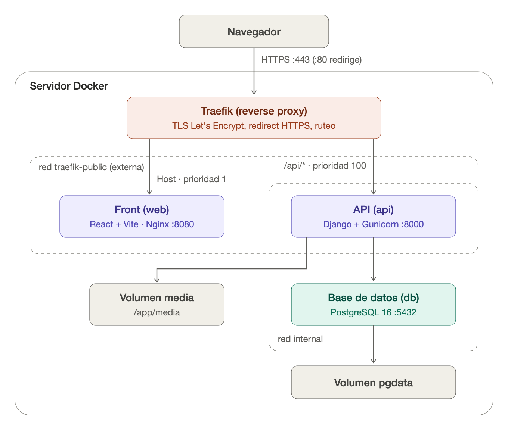

# Arquitectura de despliegue

Comfy Chair se despliega con Docker en un único servidor, detrás de un reverse proxy Traefik. El sistema se reparte en dos repositorios:

- `comfy-chair-2026`: frontend (React + Vite).
- `comfy-chair-api-2026`: API (Django) y base de datos (PostgreSQL).



## Componentes

| Servicio | Imagen / tecnología | Puerto interno | Repo |
|---|---|---|---|
| Traefik | Reverse proxy (se despliega aparte) | 80 / 443 | — |
| `web` | Build de Vite servido por Nginx 1.27 | 8080 | `comfy-chair-2026` |
| `api` | Django 5 + DRF sobre Gunicorn (3 workers) | 8000 | `comfy-chair-api-2026` |
| `db` | PostgreSQL 16 | 5432 | `comfy-chair-api-2026` |

## Flujo de un request

1. El navegador entra a `https://APP_HOST`. Los requests por HTTP (puerto 80) se redirigen a HTTPS.
2. Traefik termina TLS con un certificado de Let's Encrypt. El certificado lo obtiene y lo renueva automáticamente el resolver ACME `myresolver`.
3. Traefik decide a qué servicio mandar el request según los `labels` de cada contenedor:
   - `Host(APP_HOST) && PathPrefix(/api)` va a `api` (prioridad 100).
   - `Host(APP_HOST)` va a `web` (prioridad 1). Es la regla por defecto para todo lo demás.
4. Front y API comparten el mismo dominio, así que no hay problemas de CORS entre ellos. Por la misma razón, los archivos estáticos (`/api/static/`, servidos con WhiteNoise) y los de media (`/api/media/`) también van bajo `/api`.

## Redes y volúmenes

- `traefik-public` es una red externa (se crea una vez en el servidor) que comparten Traefik, `web` y `api`.
- `internal` es la red privada entre `api` y `db`. La base de datos no está expuesta a Traefik ni a internet.
- `pgdata` guarda los datos de PostgreSQL.
- `media` guarda los archivos subidos por los usuarios (`/app/media`).

## Build y arranque

- **Front:** se construye en dos etapas. Primero `npm ci` y `vite build`, después Nginx sirve los archivos generados. Las variables `VITE_*` se fijan **en el build**, así que si cambian hay que reconstruir la imagen. Nginx devuelve `index.html` para cualquier ruta desconocida, porque es una SPA.
- **API:** al arrancar, `docker-entrypoint.sh` corre `migrate` y después levanta Gunicorn. `api` espera a que el healthcheck de `db` dé OK antes de arrancar.

## Configuración

Cada repo tiene un `.env.example`. La variable clave es `APP_HOST`, que tiene que tener el mismo valor en los dos repos. En la API también son obligatorias `SECRET_KEY` y `POSTGRES_PASSWORD`.

```bash
docker network create traefik-public   # una sola vez, si no existe
docker compose up -d --build           # en cada repo
```
